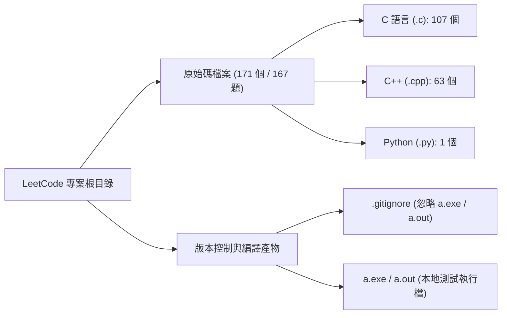

# LeetCode 解題紀錄資料庫架構與內容分析

> 利用 antigravity 彙總

本專案為 **LeetCode 演算法題解與本地驗證資料庫**，採用扁平化（Flat Structure）目錄結構管理，涵蓋 C、C++ 與 Python 三種語言之實作。

---

## 1. 資料夾總覽與統計指標

| 統計項目 | 數量 / 比例 | 說明 |
| :--- | :--- | :--- |
| **總檔案數** | **174 個檔案** | 含 171 個原始碼檔案、1 個 `.gitignore`、2 個本地編譯產物 |
| **已解獨立題目數 (Unique Problems)** | **167 題** | 題號涵蓋範圍：`#2` 至 `#3970` |
| **C 語言題解 (`.c`)** | **107 個** (62.6%) | 主力刷題語言，涵蓋基礎資料結構、指標操作、手刻 Heap 與 `uthash` |
| **C++ 題解 (`.cpp`)** | **63 個** (36.8%) | 集中於中後期題號（`#1000+`）與進階題型，善用 STL 容器與演算法 |
| **Python 題解 (`.py`)** | **1 個** (0.6%) | [`3643.py`](./3643.py)（與 C++ 雙語對照實作） |
| **多語言/多解法題目** | **4 題** | `#118`、`#326`、`#2006`、`#3643` |
| **其他專案檔案** | **3 個** | [`.gitignore`](./.gitignore)、`a.exe`、`a.out` |

---

## 2. 檔案命名與程式碼架構分析

### 2.1 命名規範演進
1. **早期帶題目名稱命名（3 個檔案）**：
   - [`09. Palindrome Number.c`](./09.%20Palindrome%20Number.c)
   - [`21. Merge Two Sorted Lists.c`](./21.%20Merge%20Two%20Sorted%20Lists.c)
   - [`22. Generate Parentheses.c`](./22.%20Generate%20Parentheses.c)
2. **標準純題號命名（168 個檔案）**：
   - 統一採用 `<題號>.<副檔名>`（如 [`2.c`](./2.c)、[`1948.cpp`](./1948.cpp)、[`3643.py`](./3643.py)），簡潔且便於快速搜尋與命令列編譯。

### 2.2 兩種程式碼結構模式
1. **LeetCode 核心函式 / 類別提交模式（約佔 95%）**
   - **C 語言**：直接定義題目要求的函式（如 `addTwoNumbers`、`combinationSum2`）與輔助函式，檔案開頭保留 LeetCode 記憶體管理或資料結構定義註解（如 `struct ListNode`、`struct TreeNode`）。
   - **C++ / Python**：標準 `class Solution` 封裝結構（如 `Solution::deleteDuplicateFolder`），多數檔案開頭引入對應標頭檔（`<vector>`、`<unordered_map>`、`<algorithm>` 等）以利本地 IDE 語法檢查。
2. **完整本地可執行互動驗證模式（含 `main()` 函式）**
   - 針對需要本地輸入測資除錯的題目，檔案中除了核心演算法外，還包含 `#include <stdio.h>` 與 `int main()` 互動式測試介面（使用 `scanf` / `printf` 讀取測資並印出結果）：
     - [`09. Palindrome Number.c`](./09.%20Palindrome%20Number.c) (`isPalindrome`)
     - [`45.c`](./45.c) (`jump`)
     - [`50.c`](./50.c) (`myPow`)
     - [`3970.c`](./3970.c) (`shortestPath`，包含透過環境變數 `DEBUG` 控制的 `debug(...)` 巨集與 `stderr` 追蹤機制)

### 2.3 語言選用策略與演算法實作特色
- **題號 `#1 ~ #600`（共 100 題）**：以 **C 語言** 為主（93 個 `.c` 檔，僅 7 個 `.cpp` 檔）。展現扎實的底層實作能力：
  - 手刻 Circular Queue 實作 Stack（[`225.c`](./225.c)）與雙 Stack 實作 Queue（[`232.c`](./232.c)）。
  - 動態陣列空間倍增（`realloc` 倍增容量於 [`40.c`](./40.c)）。
  - 手刻陣列式 Min-Heap 與 Linked-List Adjacency List 實作狀態擴展版 Dijkstra 最短路徑（[`3970.c`](./3970.c)）。
  - 運用 `uthash` 巨集在 C 語言中實作雜湊表（[`1865.c`](./1865.c)）。
- **題號 `#700+`（共 67 題）**：以 **C++** 為主（56 個 `.cpp` 檔，11 個 `.c` 檔）。面對每日挑戰（Daily Challenge）與周賽中高難度題型時，改用 C++ 搭配 `std::priority_queue`、`std::unordered_map` 與結構化綁定（`auto [x, y]`）提升開發效率。
- **詳盡的繁體中文推導註解**：許多關鍵題目附有完整的數學證明、時間複雜度分析與演算法思路（如 [`22. Generate Parentheses.c`](./22.%20Generate%20Parentheses.c) 的卡塔蘭數證明、[`141.c`](./141.c) 的 Floyd 判圈法複雜度推導、[`3333.c`](./3333.c) 的動態規劃結合前綴和優化推導、[`3479.cpp`](./3479.cpp) 的根號分解法說明）。

---

## 3. 核心演算法與資料結構主題分類

| 演算法 / 資料結構領域 | 代表檔案與實作亮點 |
| :--- | :--- |
| **1. 鏈結串列 (Linked List)** | [`2.c`](./2.c) (大數相加)、[`19.c`](./19.c)、[`21. Merge Two Sorted Lists.c`](./21.%20Merge%20Two%20Sorted%20Lists.c)、[`24.c`](./24.c)、[`83.c`](./83.c)、[`141.c`](./141.c) (快慢指標判環)、[`160.c`](./160.c) (雙指標相交節點)、[`203.c`](./203.c)、[`206.c`](./206.c)、[`234.c`](./234.c)、[`1290.cpp`](./1290.cpp) |
| **2. 樹與字典樹 (Trees, BST & Trie)** | [`94.c`](./94.c)、[`100.c`](./100.c)、[`101.c`](./101.c)、[`104.c`](./104.c)、[`108.c`](./108.c) (分治建構平衡 BST)、[`110.c`](./110.c)、[`111.c`](./111.c)、[`112.c`](./112.c)、[`144.c`](./144.c)、[`145.c`](./145.c)、[`222.c`](./222.c)、[`226.c`](./226.c)、[`257.c`](./257.c)、[`404.cpp`](./404.cpp)、[`1948.cpp`](./1948.cpp) (Trie + 子樹序列化刪除重複資料夾)、[`2322.cpp`](./2322.cpp) (雙層樹狀 DFS 與 XOR 性質) |
| **3. 動態規劃與記憶化搜尋 (DP)** | [`5.c`](./5.c)、[`70.c`](./70.c)、[`118.c`](./118.c) / [`118.cpp`](./118.cpp)、[`119.c`](./119.c)、[`121.c`](./121.c)、[`338.c`](./338.c)、[`712.cpp`](./712.cpp)、[`1262.cpp`](./1262.cpp) (餘數狀態 DP 與 Greedy 雙解比較)、[`1900.cpp`](./1900.cpp) (3D 記憶化 DP 結合對稱狀態壓縮)、[`3201.cpp`](./3201.cpp)、[`3202.cpp`](./3202.cpp)、[`3333.c`](./3333.c) (前綴和加速 DP) |
| **4. 回溯法與遞迴 (Backtracking)** | [`17.c`](./17.c) (電話號碼字母組合)、[`22. Generate Parentheses.c`](./22.%20Generate%20Parentheses.c) (卡塔蘭數預配置 + 遞迴)、[`39.c`](./39.c)、[`40.c`](./40.c) (排序剪枝去重)、[`46.cpp`](./46.cpp) (全排列)、[`401.cpp`](./401.cpp)、[`2044.cpp`](./2044.cpp) |
| **5. 二分搜尋與分治 (Binary Search)** | [`33.c`](./33.c) (旋轉排序陣列搜尋)、[`34.c`](./34.c) (雙模式二分搜尋左右邊界)、[`35.c`](./35.c)、[`50.c`](./50.c) (快速冪)、[`69.c`](./69.c)、[`278.c`](./278.c)、[`367.c`](./367.c)、[`374.c`](./374.c)、[`1498.c`](./1498.c) |
| **6. 雙指標與滑動視窗 (Two Pointers & Sliding Window)** | [`3.c`](./3.c) (無重複最長子字串)、[`11.c`](./11.c)、[`16.c`](./16.c)、[`18.c`](./18.c) (排序 + 雙指標 4Sum)、[`31.c`](./31.c) (Next Permutation)、[`75.c`](./75.c)、[`88.c`](./88.c)、[`904.cpp`](./904.cpp)、[`1695.cpp`](./1695.cpp)、[`2411.cpp`](./2411.cpp) (Bitwise OR 滑動視窗)、[`3439.c`](./3439.c) |
| **7. 優先佇列、圖論與區間結構 (Heap, Graph & Sqrt Decomposition)** | [`2163.cpp`](./2163.cpp) (前後綴 Min/Max Heap)、[`2402.cpp`](./2402.cpp) (雙 Min-Heap 模擬會議室排程)、[`3478.cpp`](./3478.cpp)、[`3479.cpp`](./3479.cpp) (Square Root Decomposition 根號分解法)、[`3970.c`](./3970.c) (手刻 Min-Heap + 狀態空間 Dijkstra) |
| **8. 貪婪與雜湊映射 (Greedy & Hash Table)** | [`45.c`](./45.c) (區間跳躍)、[`1865.c`](./1865.c) (`uthash` 設計題)、[`1590.cpp`](./1590.cpp)、[`1717.cpp`](./1717.cpp)、[`2561.cpp`](./2561.cpp) (媒介元素最小交換成本)、[`3480.cpp`](./3480.cpp) (衝突對枚舉最大化子陣列) |
| **9. 位元運算、數學與矩陣操作 (Bit, Math & Matrix)** | [`6.c`](./6.c) (Z 字形週期數學推導)、[`36.c`](./36.c)、[`48.c`](./48.c) (矩陣轉置+水平翻轉)、[`136.c`](./136.c)、[`190.c`](./190.c)、[`191.c`](./191.c)、[`231.c`](./231.c)、[`326.c`](./326.c) / [`326.cpp`](./326.cpp) (對數法 vs `3^19` 整除法)、[`898.cpp`](./898.cpp)、[`2419.cpp`](./2419.cpp)、[`3643.cpp`](./3643.cpp) |

---

## 4. 多語言 / 多實作對照題目分析

1. **#118 Pascal's Triangle**：
   - [`118.c`](./118.c)：手動 `malloc` 二維指標陣列與 `*returnColumnSizes`。
   - [`118.cpp`](./118.cpp)：使用 `std::vector<vector<int>>` 與 `push_back` 自動管理記憶體。
2. **#326 Power of Three**：
   - [`326.c`](./326.c)：使用換底公式 `log(n)/log(3)` 並搭配 `1e-10` 處理浮點數誤差。
   - [`326.cpp`](./326.cpp)：利用 32-bit 有號整數內最大 3 的次方 `3^19 = 1162261467` 進行 `O(1)` 模數整除判斷。
3. **#2006 Count Number of Pairs With Absolute Difference K**：
   - [`2006.c`](./2006.c) 與 [`2006.cpp`](./2006.cpp)：皆使用大小為 100 的計數陣列達成單次遍歷 `O(N)` 時間複雜度。
4. **#3643 Flip Square Submatrix Vertically**：
   - [`3643.cpp`](./3643.cpp) 與 [`3643.py`](./3643.py)：對照 C++ `tmp` 變數交換與 Python Tuple Unpacking 原地交換語法。

---

## 5. 完整檔案索引清單（依題號區間分類）

### 區間一：#1 ~ #99（共 40 題 / 40 檔）
- [`2.c`](./2.c) (`addTwoNumbers`)
- [`3.c`](./3.c) (`lengthOfLongestSubstring`)
- [`5.c`](./5.c) (`longestPalindrome`)
- [`6.c`](./6.c) (`convert`)
- [`7.c`](./7.c) (`reverse`)
- [`8.c`](./8.c) (`myAtoi`)
- [`09. Palindrome Number.c`](./09.%20Palindrome%20Number.c) (`isPalindrome`, 含 `main`)
- [`11.c`](./11.c) (`maxArea`)
- [`12.c`](./12.c) (`intToRoman`)
- [`16.c`](./16.c) (`threeSumClosest`)
- [`17.c`](./17.c) (`letterCombinations`)
- [`18.c`](./18.c) (`fourSum`)
- [`19.c`](./19.c) (`removeNthFromEnd`)
- [`21. Merge Two Sorted Lists.c`](./21.%20Merge%20Two%20Sorted%20Lists.c) (`mergeTwoLists`)
- [`22. Generate Parentheses.c`](./22.%20Generate%20Parentheses.c) (`generateParenthesis`)
- [`24.c`](./24.c) (`swapPairs`)
- [`28.c`](./28.c) (`strStr`)
- [`29.c`](./29.c) (`divide`)
- [`31.c`](./31.c) (`nextPermutation`)
- [`33.c`](./33.c) (`search`)
- [`34.c`](./34.c) (`searchRange`)
- [`35.c`](./35.c) (`searchInsert`)
- [`36.c`](./36.c) (`isValidSudoku`)
- [`38.c`](./38.c) (`countAndSay`)
- [`39.c`](./39.c) (`combinationSum`)
- [`40.c`](./40.c) (`combinationSum2`)
- [`43.cpp`](./43.cpp) (`multiply`)
- [`45.c`](./45.c) (`jump`, 含 `main`)
- [`46.cpp`](./46.cpp) (`permute`)
- [`48.c`](./48.c) (`rotate`)
- [`50.c`](./50.c) (`myPow`, 含 `main`)
- [`58.c`](./58.c) (`lengthOfLastWord`)
- [`66.c`](./66.c) (`plusOne`)
- [`67.c`](./67.c) (`addBinary`)
- [`69.c`](./69.c) (`mySqrt`)
- [`70.c`](./70.c) (`climbStairs`)
- [`75.c`](./75.c) (`sortColors`)
- [`83.c`](./83.c) (`deleteDuplicates`)
- [`88.c`](./88.c) (`merge`)
- [`94.c`](./94.c) (`inorderTraversal`)

### 區間二：#100 ~ #999（共 65 題 / 67 檔）
- **#100 ~ #199**：[`100.c`](./100.c)、[`101.c`](./101.c)、[`104.c`](./104.c)、[`108.c`](./108.c)、[`110.c`](./110.c)、[`111.c`](./111.c)、[`112.c`](./112.c)、[`118.c`](./118.c)、[`118.cpp`](./118.cpp)、[`119.c`](./119.c)、[`121.c`](./121.c)、[`125.c`](./125.c)、[`136.c`](./136.c)、[`141.c`](./141.c)、[`144.c`](./144.c)、[`145.c`](./145.c)、[`160.c`](./160.c)、[`168.c`](./168.c)、[`169.c`](./169.c)、[`171.c`](./171.c)、[`190.c`](./190.c)、[`191.c`](./191.c)
- **#200 ~ #299**：[`202.c`](./202.c)、[`203.c`](./203.c)、[`205.c`](./205.c)、[`206.c`](./206.c)、[`217.c`](./217.c)、[`219.c`](./219.c)、[`222.c`](./222.c)、[`225.c`](./225.c)、[`226.c`](./226.c)、[`228.c`](./228.c)、[`231.c`](./231.c)、[`232.c`](./232.c)、[`234.c`](./234.c)、[`242.c`](./242.c)、[`257.c`](./257.c)、[`258.c`](./258.c)、[`263.c`](./263.c)、[`268.c`](./268.c)、[`278.c`](./278.c)、[`283.c`](./283.c)、[`290.c`](./290.c)、[`292.c`](./292.c)
- **#300 ~ #999**：[`303.c`](./303.c)、[`326.c`](./326.c)、[`326.cpp`](./326.cpp)、[`338.c`](./338.c)、[`342.c`](./342.c)、[`344.c`](./344.c)、[`345.c`](./345.c)、[`349.c`](./349.c)、[`350.c`](./350.c)、[`367.c`](./367.c)、[`374.c`](./374.c)、[`383.c`](./383.c)、[`387.c`](./387.c)、[`389.cpp`](./389.cpp)、[`392.cpp`](./392.cpp)、[`401.cpp`](./401.cpp)、[`404.cpp`](./404.cpp)、[`594.c`](./594.c)、[`598.c`](./598.c)、[`599.c`](./599.c)、[`712.cpp`](./712.cpp)、[`717.cpp`](./717.cpp)、[`898.cpp`](./898.cpp)、[`904.cpp`](./904.cpp)

### 區間三：#1000 ~ #3970（共 62 題 / 64 檔）
- **#1000 ~ #1999**：[`1015.cpp`](./1015.cpp)、[`1018.cpp`](./1018.cpp)、[`1233.cpp`](./1233.cpp)、[`1262.cpp`](./1262.cpp)、[`1290.cpp`](./1290.cpp)、[`1304.cpp`](./1304.cpp)、[`1323.cpp`](./1323.cpp)、[`1394.c`](./1394.c)、[`1399.cpp`](./1399.cpp)、[`1437.cpp`](./1437.cpp)、[`1498.c`](./1498.c)、[`1513.cpp`](./1513.cpp)、[`1523.cpp`](./1523.cpp)、[`1590.cpp`](./1590.cpp)、[`1695.cpp`](./1695.cpp)、[`1717.cpp`](./1717.cpp)、[`1865.c`](./1865.c)、[`1900.cpp`](./1900.cpp)、[`1930.cpp`](./1930.cpp)、[`1948.cpp`](./1948.cpp)、[`1957.cpp`](./1957.cpp)
- **#2000 ~ #2999**：[`2006.c`](./2006.c)、[`2006.cpp`](./2006.cpp)、[`2044.cpp`](./2044.cpp)、[`2099.c`](./2099.c)、[`2154.cpp`](./2154.cpp)、[`2163.cpp`](./2163.cpp)、[`2200.cpp`](./2200.cpp)、[`2210.cpp`](./2210.cpp)、[`2264.cpp`](./2264.cpp)、[`2322.cpp`](./2322.cpp)、[`2401.cpp`](./2401.cpp)、[`2402.cpp`](./2402.cpp)、[`2410.cpp`](./2410.cpp)、[`2411.cpp`](./2411.cpp)、[`2419.cpp`](./2419.cpp)、[`2460.cpp`](./2460.cpp)、[`2465.c`](./2465.c)、[`2561.cpp`](./2561.cpp)、[`2570.cpp`](./2570.cpp)、[`2965.cpp`](./2965.cpp)
- **#3000 ~ #3970**：[`3000.cpp`](./3000.cpp)、[`3021.cpp`](./3021.cpp)、[`3025.cpp`](./3025.cpp)、[`3136.cpp`](./3136.cpp)、[`3190.cpp`](./3190.cpp)、[`3201.cpp`](./3201.cpp)、[`3202.cpp`](./3202.cpp)、[`3304.c`](./3304.c)、[`3330.c`](./3330.c)、[`3333.c`](./3333.c)、[`3392.cpp`](./3392.cpp)、[`3439.c`](./3439.c)、[`3446.cpp`](./3446.cpp)、[`3477.cpp`](./3477.cpp)、[`3478.cpp`](./3478.cpp)、[`3479.cpp`](./3479.cpp)、[`3480.cpp`](./3480.cpp)、[`3512.cpp`](./3512.cpp)、[`3516.cpp`](./3516.cpp)、[`3643.cpp`](./3643.cpp)、[`3643.py`](./3643.py)、[`3970.c`](./3970.c)
